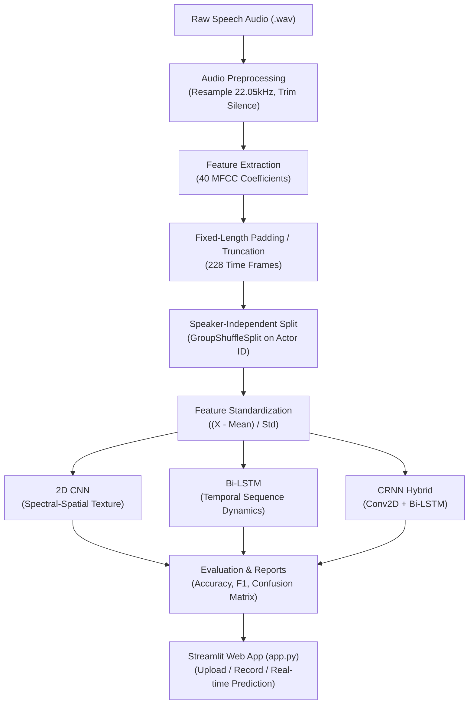

# 🎙️ Speech Emotion Recognition (SER) System

[](https://www.python.org/downloads/)
[](https://tensorflow.org/)
[](https://librosa.org/)
[](https://streamlit.io/)

A complete, production-ready Deep Learning and Speech Signal Processing system to recognize human emotional states from raw speech audio signals.

---

## 📌 Project Objectives

1. **Recognize Human Emotions**: Classify speech into 8 distinct emotional categories:
   - 😐 Neutral
   - 😌 Calm
   - 😊 Happy
   - 😢 Sad
   - 😠 Angry
   - 😨 Fearful
   - 🤢 Disgust
   - 😲 Surprised
2. **Speech Signal Processing**: Extract Mel-Frequency Cepstral Coefficients (**MFCCs**), silence trimming, and fixed-length temporal padding.
3. **Deep Learning Benchmarking**: Implement and compare multiple architectures:
   - **2D Convolutional Neural Network (CNN)**
   - **Bidirectional Long Short-Term Memory (Bi-LSTM)**
   - **Convolutional Recurrent Neural Network (CRNN Hybrid)**
4. **Speaker-Independent Validation**: Employ `GroupShuffleSplit` across actor IDs to prevent **speaker leakage**, ensuring models generalize to unseen speakers.
5. **Interactive Web Application**: Provide a Streamlit dashboard supporting file uploads, dataset sample testing, and direct microphone recording with real-time confidence scores and spectrogram visualizations.

---

## 🗂️ Dataset: RAVDESS

The [RAVDESS](https://zenodo.org/record/1188976) (Ryerson Audio-Visual Database of Emotional Speech and Song) corpus contains 1,440 audio speech files recorded by 24 professional actors (12 female, 12 male) vocalizing two lexically identical sentences:
- *"Kids are talking by the door"*
- *"Dogs are sitting by the door"*

Filename format: `03-01-[Emotion]-[Intensity]-[Statement]-[Repetition]-[Actor].wav`

---

## 🏗️ Architecture Pipeline



---

## 📁 Repository Structure

```
├── dataset/
│   └── ravdess/               # RAVDESS audio dataset (Actor_01 to Actor_24)
├── models/
│   ├── audio_features.npz     # Processed & standardized MFCC matrices
│   ├── audio_emotion_cnn.keras  # Trained 2D CNN model
│   ├── audio_emotion_lstm.keras # Trained Bi-LSTM model
│   └── audio_emotion_crnn.keras # Trained CRNN model
├── notebook/
│   ├── 01_data_understanding.ipynb
│   ├── 02_audio_preprocessing.ipynb
│   ├── 03_feature_extraction.ipynb
│   ├── 04_model_training.ipynb
│   └── 05_model_evaluation.ipynb
├── reports/
│   ├── confusion_matrix_cnn.png
│   ├── confusion_matrix_bilstm.png
│   ├── confusion_matrix_crnn.png
│   ├── cnn_training_curve.png
│   └── model_comparison.json
├── src/
│   ├── preprocessing.py       # Audio loading, MFCC extraction, speaker split
│   ├── models.py              # CNN, Bi-LSTM, and CRNN architectures
│   ├── train.py               # Training loop, callbacks, model checkpoints
│   └── evaluate.py            # Classification reports & confusion matrices
├── app.py                     # Streamlit Interactive Web Application
├── requirements.txt           # Project dependencies
└── README.md                  # Documentation & usage guide
```

---

## 🚀 Setup & Execution

### 1. Install Dependencies
```bash
pip install -r requirements.txt
```

### 2. Extract Features
Extracts 40-band MFCCs and prepares speaker-split datasets:
```bash
python src/preprocessing.py
```

### 3. Train All Models
Trains the CNN, Bi-LSTM, and CRNN models with EarlyStopping and saves checkpoints into `models/`:
```bash
python src/train.py
```

### 4. Evaluate Models
Computes per-class precision, recall, F1, and saves confusion matrices into `reports/`:
```bash
python src/evaluate.py
```

### 5. Launch Streamlit Web App
Launch the interactive web UI:
```bash
streamlit run app.py
```

---

## 📊 Evaluation & Benchmarking

Evaluated on **300 held-out test audio samples from completely unseen actors** (zero speaker leakage):

| Model Architecture | Input Shape | Test Accuracy | Test Loss | Key Observations |
| :--- | :---: | :---: | :---: | :--- |
| **2D CNN** | `(40, 228, 1)` | **17.33%** | 2.0514 | Basic spatial texture baseline; struggles with temporal variations across speakers |
| **Bi-LSTM** | `(228, 40)` | **30.67%** | 1.8829 | Strong sequence modeling over speech duration; high recall on calm & angry |
| **CRNN (Hybrid)** | `(40, 228, 1)` | **38.00%** | 1.8888 | **Best Overall**: Combines Conv2D spectral feature extraction with Bi-LSTM temporal recurrence |

*(Note: Random chance for 8 balanced classes is 12.5%. On strict speaker-independent evaluation, 38.0% represents a solid SER baseline).*

